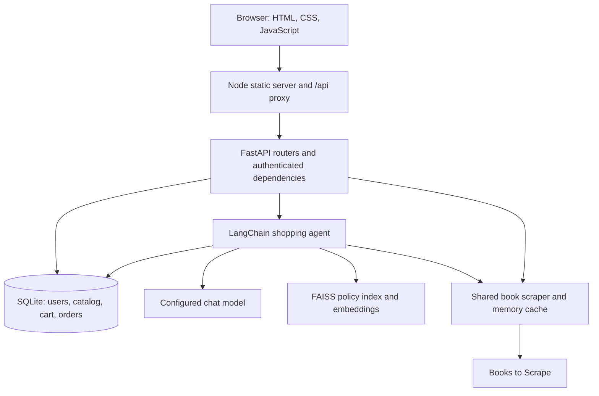
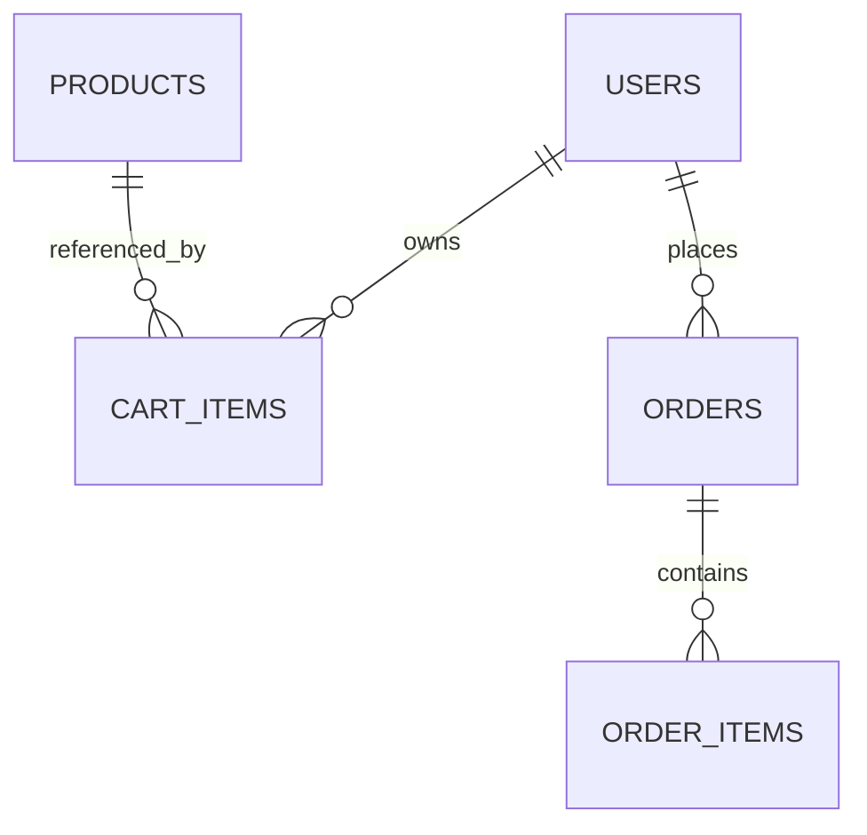
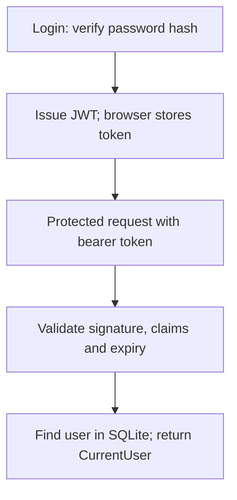
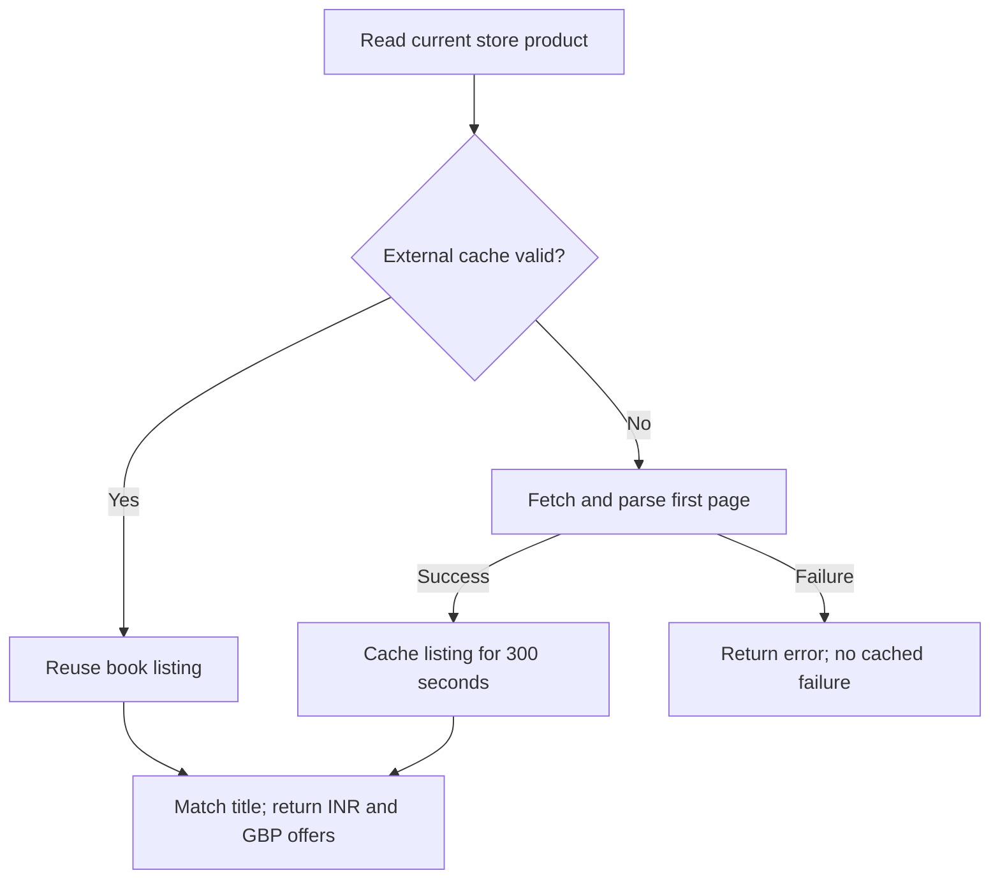

# Everyday - Low-Level Design

**Implementation snapshot:** 12 October 2026 | **Project:** Book ecommerce demo

## 1. System overview

Everyday combines a book storefront, an authenticated cart and unpaid checkout with an AI shopping assistant. Visitors browse books and compare store prices with Books to Scrape. Signed-in users can find products through chat, add requested items, ask policy questions and retrieve their own orders.

The 12 demo book titles match the source's first page. Startup renames matching legacy demo products in place, preserving IDs, prices and stock. Custom products remain. Store prices are INR; scraped prices are GBP.

### Runtime architecture



| Component | Responsibility |
| --- | --- |
| `frontend/public/app.js` | API requests, account/cart state, chat history, cards and comparison dialog |
| `frontend/server.mjs` | Static assets and `/api` forwarding to FastAPI |
| `app/routers/` and `app/schemas/` | HTTP contracts, input validation and errors |
| `app/core/` | Environment configuration, password hashing and JWT verification |
| `app/services/` | Catalog, cart, orders, chat, seeding and scraping |
| `app/ai/` | Agent instructions, tools, model client and policy retrieval |
| `app/models/` and `app/database.py` | SQLModel tables and SQLite sessions |

<!-- pagebreak -->

## 2. Database design

SQLite lives at `backend/ecommerce.db`. SQLModel sessions manage queries and transactions. Startup creates missing tables with `create_all()`; a schema migration framework is not implemented.



| Table | Fields and constraints |
| --- | --- |
| `users` | `id` PK; unique indexed `email`; `full_name`; `hashed_password`. Email normalized to lowercase. |
| `products` | `id` PK; `name`; integer `price_paise`; boolean `in_stock`. No inventory count. |
| `cart_items` | `id` PK; `user_id` FK; `product_id` FK; `quantity`. Unique `(user_id, product_id)`. |
| `orders` | `id` PK; `user_id` FK; `checkout_key`; `request_hash`; UTC text `created_at`; `status`; `total_paise`; recipient/address fields. Unique `(user_id, checkout_key)`. |
| `order_items` | `id` PK; `order_id` FK; snapshot `product_id`, `name`, `quantity`, `unit_price_paise`, `subtotal_paise`. |

### Storage invariants

- Integer `12550` means INR 125.50. Scraped `5177` means GBP 51.77. Currency conversion is not implemented.
- Order lines preserve purchased names and prices after catalog edits/deletion. Their product ID is a snapshot, not a foreign key to the live catalog.
- Shipping fields are stored on the order and serialized as a nested `shipping` object.
- New orders are `pending_payment`; payment, fulfillment and stock reservation are absent.
- SQLite FK enforcement is not explicitly enabled by engine configuration. Services perform ownership and product checks; there are no automatic cascade guarantees.
- Seeding acquires `BEGIN IMMEDIATE`, migrates matching legacy titles and inserts missing books. Existing book prices and stock remain; deleted seed titles can reappear on restart.

<!-- pagebreak -->

## 3. HTTP contracts

Browser paths use `/api`; the proxy removes that prefix and forwards authorization and JSON content headers. FastAPI enforces authentication.

| Method and backend path | Access | Behavior |
| --- | --- | --- |
| `GET /health` | Public | Health response |
| `POST /auth/register` | Public | Create user; duplicate email: `409` |
| `POST /auth/login` | Public | JWT, `expires_in=1800`; invalid credentials: `401` |
| `GET /users/me` | Bearer | Current public user profile |
| `GET /products`, `GET /products/{id}` | Public | Catalog/product; missing: `404` |
| `GET /products/{id}/compare` | Public | Store/external offers, timestamp and message |
| `POST /products`, `DELETE /products/{id}` | Public currently | Catalog writes; administrator protection pending |
| `GET /cart` | Bearer | Owned cart, product details and INR total |
| `POST /cart/items` | Bearer | Add quantity; merge existing product line |
| `PATCH /cart/items/{id}` | Bearer | Replace owned line quantity |
| `DELETE /cart/items/{id}` | Bearer | Remove owned line |
| `POST /orders` | Bearer | Create/replay unpaid order; conflict: `409` |
| `GET /orders`, `GET /orders/{id}` | Bearer | Owned history/details |
| `POST /chat` | Bearer | `{reply, products}`; assistant failure: `503` |

### Representative payloads

```json
{"product_id": 1, "quantity": 2}

{"message": "Compare A Light in the Attic",
 "history": [{"role": "user", "content": "Show me books"}]}
```

Use actual IDs returned by the catalog. Cart quantities are 1-100. Missing/unowned cart and order entries share not-found behavior. Comparison source failures return `503`; no matching title returns success with `external: null`. Input validation errors use `422`.

<!-- pagebreak -->

## 4. Authentication and chat history

### Authentication lifecycle

Registration stores an Argon2 password hash using `pwdlib`. Login normalizes the email and verifies the hash. Unknown emails also perform dummy-hash verification and receive the same invalid-credentials response.

JWTs use HS256 and `JWT_SECRET_KEY` from the root `.env`; startup requires at least 32 bytes. Tokens contain user ID `sub`, issue time `iat` and expiry `exp`, and last 30 minutes. JWTs are signed, not encrypted.



`get_current_user()` in `core/dependencies.py` verifies every protected request. Missing/invalid/expired tokens or deleted users return `401`. `/users/me` restores the frontend account display after login and reload. The server binds the verified ID into agent tools.

The token is kept in tab `sessionStorage`, with a page-memory fallback. Logout clears local state without server-side revocation. No refresh tokens or password reset are implemented.

### Conversation context

`chatHistory` is a browser-memory array. Successful exchanges append user/assistant text and retain the latest 12 messages. Each entry is limited to 2,000 characters; assistant replies are truncated for future context. The backend accepts only user/assistant roles.

Each request sends bounded history plus the latest message. The service creates a user-bound agent and invokes it with that history followed by the new message. Tool results stay within the invocation and are not retained in future client history. Product cards are returned separately.

Refresh, Clear conversation, logout and authenticated session expiry clear history. Closing the dialog keeps it. Late replies after a user-session change are discarded. There is no persistent chat database, checkpointer or server-side conversation thread.

<!-- pagebreak -->

## 5. Agent tools and order access

`get_shopping_agent(user_id)` creates an agent per request. Its model client is cached separately, while user-bound tools are recreated. Instructions restrict answers to the storefront, products, policies and the user's orders.

| Tool | Inputs | Result |
| --- | --- | --- |
| `list_products` | None | Current IDs, names, INR prices and stock |
| `show_products` | 1-6 product IDs | Validated cards; no scraping or cart change |
| `compare_product_price` | Product ID | Shared comparison result or failure |
| `search_store_policies` | Question | Up to four passages with source/page references |
| `add_to_cart` | Product ID, quantity | User-bound cart mutation; quantity 1-100 |
| `list_my_orders` | Limit 1-50, offset | User-bound history, newest first, pagination |
| `get_my_order` | Order ID | Owned full details including shipping address |

### Products and comparison

The agent resolves names using current catalog results. Searches/recommendations can call `show_products`; only successful tool output populates the response's `products` array, capped at six cards. Cards have Compare price buttons and are not inferred from model reply text.

Explicit product-price comparison calls the comparison tool. Button clicks call the HTTP comparison endpoint. Both share the scraper/cache. Ambiguous names should trigger clarification. INR and GBP are reported separately with a source link/check time; cross-currency savings are not calculated.

### Order ownership

`make_order_tools(user_id)` binds identity through closures; the model cannot choose a user ID. Detail queries filter by both order and user IDs. Another user's order and a nonexistent order return the same error. Listing defaults to 20 orders and returns `has_more`/`next_offset`; full shipping details require a detail lookup.

Orders are read fresh from SQLite using purchase snapshots, not today's catalog prices. The agent should paginate before claiming complete spending totals or no matching purchase. It cannot change/cancel orders, refund payments or track parcels. A saved address is not tracking data.

Cart additions require an explicit latest-user request. A lock and per-turn result map prevent repeating an addition for the same product within one request; separate HTTP retries are not covered by this safeguard.

<!-- pagebreak -->

## 6. Book scraping and cache

`services/book_scraper.py` fetches the fixed `https://books.toscrape.com/` URL through `WebBaseLoader.scrape()`, which returns Beautiful Soup. Selectors read `article.product_pod`, the full `h3 a` title, `.price_color`, `.availability` and product links.

`Decimal` converts GBP values to integer pence. Malformed fields, negative/nonfinite prices, fractional pence and unexpected source-link hosts are rejected. Requests use explicit UTF-8, an eight-second timeout, HTTP error checks and no redirects.



| State | Purpose |
| --- | --- |
| `_cache` | Tuple: extracted book dictionaries and UTC scrape timestamp |
| `_expires` | Deadline measured with `time.monotonic()` |
| `_lock` | `threading.Lock` serializing cache checks and refreshes |

The cache is ordinary Python process memory, not Redis, SQLite or a file. All users and both comparison paths in one worker share the external listing for five minutes. Each worker has its own cache; restart clears it.

Refresh is lazy: the first comparison at/after expiry fetches a new listing. There is no scheduled refresh. Successes are cached; failures are retried next time. An expired listing is not served after a refresh failure. Store prices and orders are never cached here.

Matching uses full titles, trimming the store name and ignoring case. Only the first source page is searched; all 12 seeded titles match. Custom titles on later pages can return no match. Source prices are demo data. No exchange-rate conversion or cheaper-store calculation exists.

<!-- pagebreak -->

## 7. Cart, checkout and policy retrieval

### Cart rules

Services scope cart operations to the authenticated user. Adding a product merges quantities up to 100. Out-of-stock additions/updates fail; removal stays available. Totals use current catalog prices. Deleted products produce removable lines with null product/subtotal, excluded from the total.

### Checkout transaction

The browser submits a UUID checkout key, shipping fields, reviewed items and expected total. Validation requires 1-200 unique lines, quantities 1-100, nonnegative prices and a matching sum.

1. Acquire SQLite `BEGIN IMMEDIATE`; look up `(user_id, checkout_key)`.
2. Hash the canonical request. Same key/payload replays the existing order; a changed payload conflicts.
3. Check the owned cart against live products and reviewed quantities/prices. Reject unavailable products or changes.
4. Save a `pending_payment` order and snapshot item names, quantities and prices.
5. Delete cart lines and commit atomically; roll back both order/cart changes on failure.

When a result is uncertain, the frontend retains the checkout payload/key for a safe retry. Checkout creates an unpaid order without charging money, reserving stock or calculating shipping/tax.

### Policy retrieval (RAG)

`python -m app.ai.ingest` manually loads `ecommerce_rules_and_policies.pdf` by page, ignores empty pages and splits text into 1,000-character chunks with 200-character overlap. Embeddings and source/page metadata are saved in `backend/faiss_index`.

`retrieve_policies()` performs FAISS similarity search with `k=4`. The tool returns passages, source and one-based page numbers. The agent cites retrieved pages and acknowledges missing information instead of inventing rules.

The embedding client and index use `lru_cache`, separate from the five-minute book cache. Only the trusted local index is loaded with pickle deserialization enabled. Rebuild after policy changes and restart to reload it. Product seeding is automatic; policy ingestion is manual.

<!-- pagebreak -->

## 8. Operations, validation and limits

### Local setup

Install `backend/requirements.txt`, configure the root `.env` and run `python -m uvicorn app.main:app --reload` from backend. Run `npm.cmd run dev` from frontend and open `http://127.0.0.1:5173`.

| Configuration | Purpose |
| --- | --- |
| `JWT_SECRET_KEY` | Stable private signing secret of at least 32 bytes |
| `OPENAI_API_KEY`, `OPENAI_BASE_URL`, `OPENAI_MODEL` | Chat provider |
| `EMBEDDING_API_KEY`, `EMBEDDING_BASE_URL`, `EMBEDDING_MODEL` | Embedding provider |
| `API_TARGET`, `PORT` | Optional frontend proxy target and port |

Provider credentials stay on the backend. Conversation text and tool results, including order details when requested, are sent to the configured model to produce answers.

### Failures and timeouts

The Node proxy caps bodies at 65,536 bytes, avoids redirects and serves a same-origin content security policy. API responses are no-store. Chat timeouts: model 30 seconds with one retry; route 45; proxy 50; browser 60. Other proxy/browser requests use 15/20 seconds; scraping uses eight.

Chat failures return generic `503` responses without provider secrets. Cart writes can succeed before a final reply fails, so the UI refreshes the bag after chat and advises checking before retrying additions. Failed comparisons offer retry controls.

### Validation evidence

The latest backend suite passed 53 tests. Frontend tests passed 18 tests after chat cards were introduced; subsequent order-tool work changed no frontend code. Tests use temporary SQLite databases and simulated models. A live scrape returned 20 books and matched all 12 seeded titles. Real-provider tool selection and production deployment were not validated by those tests.

Coverage includes authentication rejection, ownership, cart limits, order snapshots, checkout replay/rollback, source parsing, cache expiry, comparison failures, product cards and simulated agent comparison/order flows. Run `python -m unittest discover -s tests -v` in backend; run `npm.cmd test` and `npm.cmd run check` in frontend.

### Future work

Catalog create/delete routes need administrator authorization before public deployment. Persistent chat, refresh tokens, server-side logout, rate limiting, password reset, migrations, book photos/categories, inventory counts, payments and fulfillment are not implemented. Comparison covers the first source page with different currencies and no conversion.

Source of truth: `app/ai/agent.py`, `app/ai/tools.py`, `app/services/book_scraper.py`, `app/services/orders.py`, `app/core/dependencies.py` and `frontend/public/app.js`.
