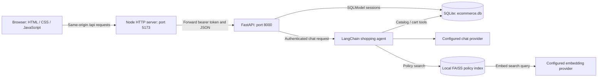
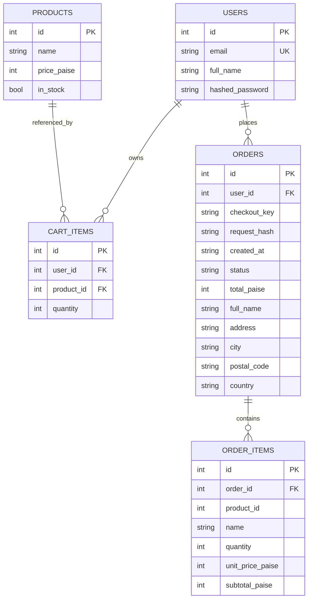
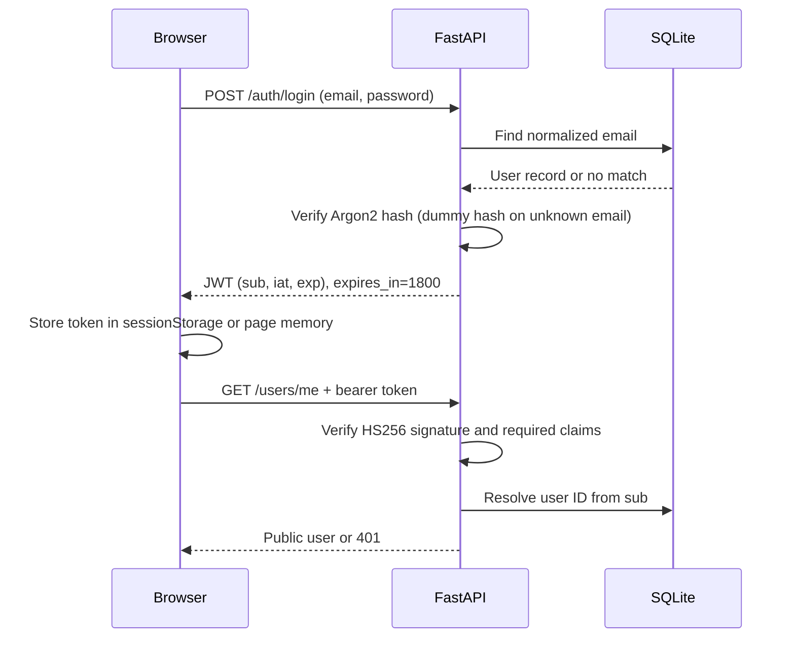
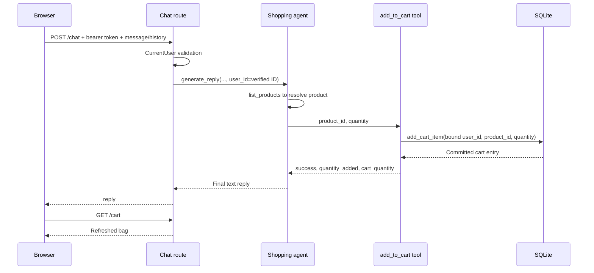

# Everyday - Low-Level Design

**Implementation snapshot:** 11 October 2026. This document describes the repository as implemented, including automatic sample catalog loading. Proposed improvements are explicitly marked. Sample-seeding tests exist but were not executed in the preceding change because execution approval was declined.

## 1. Scope and behavior

Everyday is a local ecommerce demonstration app with a browser storefront, a Node HTTP proxy, and a FastAPI backend. Visitors can browse products. Registered users can manage their cart, create unpaid orders, view their order history, and use an AI shopping assistant. The assistant can list products, retrieve store policies, and add requested products to the authenticated user's cart.

The app does not collect payments, reserve inventory, calculate shipping/tax, or fulfill orders. Availability is a boolean flag rather than a stock count. Product photos, categories, wishlists, persistent chat conversations, password reset, and an administrator role are not implemented.

## 2. Runtime architecture



The frontend server serves only `/`, `/app.js`, and `/styles.css`. It forwards `/api/*` requests after removing `/api`. `API_TARGET` defaults to `http://127.0.0.1:8000`; `PORT` defaults to `5173`. It binds to loopback. The default configuration avoids browser CORS setup.

## 3. Modules and responsibilities

| Module | Responsibility | Important functions / state |
| --- | --- | --- |
| `frontend/public/index.html` | Catalog, authentication, bag, checkout, orders, chat dialogs | Semantic forms and dialog IDs |
| `frontend/public/styles.css` | Responsive presentation | Storefront and dialog styling |
| `frontend/public/app.js` | Browser state and API orchestration | `request`, `initialize`, `renderProducts`, `refreshCart`, `sendChat`, `resetChat`, `signOut` |
| `frontend/server.mjs` | Static hosting and API forwarding | `createServer` |
| `backend/app/main.py` | Router registration and application startup | FastAPI `lifespan` |
| `backend/app/database.py` | SQLite engine, table creation, sample loading | `get_session`, `create_db_and_tables` |
| `backend/app/core/config.py` | Load root `.env` and named configuration | Chat, embedding, JWT values |
| `backend/app/core/security.py` | Argon2 password hashing and HS256 JWTs | `hash_password`, `verify_password`, `create_access_token`, `decode_access_token` |
| `backend/app/core/dependencies.py` | Authenticate HTTP requests | `CurrentUser`, `SessionDep`, `get_current_user` |
| `backend/app/routers/` | HTTP contracts and error mapping | Auth, users, products, cart, orders, chat, health |
| `backend/app/schemas/` | Pydantic request / response validation | User, product, cart, checkout, chat contracts |
| `backend/app/services/` | Application operations | Users, products, cart, orders, chat, sample catalog |
| `backend/app/models/` | Database table definitions | User, Product, CartItem, Order, OrderItem |
| `backend/app/ai/agent.py` | Assemble an agent for one chat request | `get_shopping_agent(user_id)` |
| `backend/app/ai/tools.py` | Model-callable tools | `list_products`, `search_store_policies`, `make_add_to_cart_tool` |
| `backend/app/ai/model.py` | Cached chat model configuration | `get_chat_model` |
| `backend/app/ai/rag.py` | Cached embeddings/index and policy retrieval | `get_embeddings`, `get_vector_store`, `retrieve_policies` |
| `backend/app/ai/ingest.py` | Build the policy index offline | `main` |

Routers authenticate and map service exceptions to HTTP responses. Services implement operations without requiring the browser to supply a user ID. Model tools open their own SQLModel sessions against the configured engine.

## 4. Database model



### Constraints and storage

- `users.email` is unique and indexed. Registration normalizes email case.
- `cart_items` has a unique `(user_id, product_id)` pair.
- `orders` has a unique `(user_id, checkout_key)` pair.
- `order_items.product_id` is a snapshot value, not a foreign key to current products. Names and prices remain readable after catalog changes.
- Prices and totals are integer paise. `12550` represents INR 125.50. The browser formats rupees with `Intl.NumberFormat('en-IN')`.
- `created_at` is a UTC ISO timestamp stored as text; initial order status is `pending_payment`.
- Shipping fields are stored on the order and returned as a nested `shipping` object.
- `SQLModel.metadata.create_all()` creates missing tables. There is no migration framework. Declared foreign keys do not imply cascade behavior; SQLite foreign-key enforcement is not explicitly enabled by the engine configuration.

## 5. API contract

Paths below are backend paths. The browser prefixes them with `/api`.

| Method | Path | Access currently enforced | Result / behavior |
| --- | --- | --- | --- |
| GET | `/health` | Public | `200 {"status":"ok"}` |
| POST | `/auth/register` | Public | `201` public user; duplicate email `409` |
| POST | `/auth/login` | Public | `200` bearer token; incorrect credentials `401` |
| GET | `/users/me` | Bearer token | `200` current public user |
| GET | `/products` | Public | Product array |
| GET | `/products/{product_id}` | Public | Product; missing `404` |
| POST | `/products` | Public, currently | `201` new product; admin protection is future work |
| DELETE | `/products/{product_id}` | Public, currently | `204`; missing `404` |
| GET | `/cart` | Bearer token | Items, product details, subtotals, total |
| POST | `/cart/items` | Bearer token | Add quantity to product's existing cart entry |
| PATCH | `/cart/items/{item_id}` | Bearer token | Replace quantity on an owned cart entry |
| DELETE | `/cart/items/{item_id}` | Bearer token | `204` for an owned entry |
| POST | `/orders` | Bearer token | `201` create/replay unpaid order; conflicts `409` |
| GET | `/orders` | Bearer token | Current user's orders, newest first |
| GET | `/orders/{order_id}` | Bearer token | Owned order; missing or unowned `404` |
| POST | `/chat` | Bearer token | `200 {"reply":"..."}`; assistant failure `503` |

### Representative payloads

Registration:

```json
{"email":"shopper@example.com","full_name":"Sample Shopper","password":"example-password-123"}
```

Create product:

```json
{"name":"Ceramic Coffee Mug","price_paise":29900,"in_stock":true}
```

Add cart item:

```json
{"product_id":3,"quantity":2}
```

Chat (IDs are resolved by the tool, not provided by the browser as a user identity):

```json
{
  "message":"Add 2 ceramic coffee mugs to my cart",
  "history":[
    {"role":"user","content":"What mugs do you have?"},
    {"role":"assistant","content":"There is a Ceramic Coffee Mug in the catalog."}
  ]
}
```

Checkout:

```json
{
  "checkout_key":"b6480a3a-1f8c-40dd-9a5b-46a17e16f213",
  "shipping":{"full_name":"Sample Shopper","address":"10 Sample Street","city":"Pune","postal_code":"411001","country":"India"},
  "items":[{"product_id":3,"quantity":2,"unit_price_paise":29900}],
  "expected_total_paise":59800
}
```

Product IDs are database assigned. The `3` above illustrates a payload; clients must use the actual ID returned by the catalog.

## 6. Authentication lifecycle



Startup rejects a JWT secret shorter than 32 bytes after trimming. Access tokens expire after 30 minutes. `CurrentUser` rejects missing credentials, invalid tokens, expired tokens, invalid subjects, and deleted users. Login responses use `Cache-Control: no-store` and `Pragma: no-cache`.

Registration accepts passwords of 8-128 characters and automatically leads to login in the frontend. Logout clears local state and closes sensitive dialogs; it does not revoke an already issued JWT. There are no refresh tokens or roles.

## 7. Browser state and rendering

The browser keeps `user`, `products`, `cart`, checkout state, and chat state in page memory. Only the bearer token is stored in tab-scoped `sessionStorage`, with an in-memory fallback when storage is unavailable.

`initialize()` loads the catalog and, if a token exists, resolves `/users/me` and refreshes the cart. `request()` adds JSON headers and bearer credentials only for authenticated calls. Authenticated `401` responses trigger local sign-out and an expired-session message.

`renderProducts()` filters names, optionally excludes out-of-stock products, sorts by price/name, and builds product cards. Product images are decorative initials because the schema has no image field. Dynamic text uses `textContent`, avoiding interpretation of model output or product names as HTML.

Busy flags prevent repeated UI submissions during active operations. Checkout retry data remains in page memory. Refreshing the page loses that draft; users should inspect order history after an uncertain checkout response.

## 8. Catalog startup loading

`lifespan()` validates configuration, then invokes `create_db_and_tables()`. After table creation, `seed_sample_products()` starts a SQLite `BEGIN IMMEDIATE` transaction. It compares existing product names after trimming/case-folding, inserts missing samples, and commits once.

The samples include 12 items across stationery, drinkware, bags, clothing, electronics, lighting, fitness, and candles. The Bluetooth Speaker is out of stock to demonstrate that state. Prices are fictional demo prices, not market quotations.

Existing IDs, prices, stock flags, and custom products are preserved. Matching names are not duplicated on restart. Deleting or renaming a sample allows that original sample name to be inserted again at the next startup. This is demo behavior; there is no environment toggle yet.

## 9. Cart operations

`add_cart_item()` resolves the product and checks availability. It finds an existing `(user_id, product_id)` row, increases its quantity, enforces the maximum of 100, and commits. HTTP schemas and the agent tool enforce positive quantities. `update_cart_item()` replaces quantity after ownership and stock checks. Deletion checks ownership before removing the entry.

`get_cart()` outer-joins products so deleted products remain removable. Missing product details and subtotal are `null` and excluded from the total. Out-of-stock items still appear in the bag but prevent checkout. Totals use current catalog prices rather than a reservation.

Cart IDs are entry IDs, not product IDs. Missing and unowned cart entries return the same `404`. The service always receives the user ID from verified authentication or a server-bound tool closure.

## 10. Chat agent and cart tool



Each request creates an agent with three tools: `list_products`, `search_store_policies`, and `add_to_cart`. The model client is cached, but the agent/cart-tool closure is created per request. The tool accepts only product ID and quantity; it has no model-controlled user-ID argument.

The system prompt requires an explicit user request, resolves catalog IDs, defaults unspecified quantity to one, and asks for clarification when products are ambiguous. These are model instructions, not deterministic authorization checks. Server-side authentication, cart ownership, availability, and quantity checks enforce the hard boundaries.

A lock and per-turn dictionary prevent adding the same product twice inside one request. Repeated calls for the same product return the earlier successful result, including if a later call proposes a different quantity. This does not prevent duplication across separate HTTP retries or separate chat messages.

The cart write commits before the model's final answer. Provider failure or timeout can therefore leave a successful addition saved. Error copy tells the user to check the bag before retrying. The frontend refreshes the cart in `finally`, including after a reply error when the same user session is still active. A reply arriving after sign-out is discarded.

## 11. Chat memory and limits

- `frontend/public/app.js` declares `let chatHistory = []`.
- Only successful user/assistant exchanges are added to the context array.
- The last 12 context messages are retained and sent with each request (approximately six exchanges).
- User messages and history content are limited to 2,000 characters; stored assistant context is truncated to 2,000 characters.
- History roles are only `user` or `assistant`; system-role input and extra request fields are rejected.
- Visible conversation bubbles can exceed the 12-message context window.
- Refreshing the page, clicking Clear conversation, sign-out, or an authenticated session expiry resets history. Closing the chat dialog does not reset it.
- The textbox clears immediately on send. Failed text returns only if the user has not entered a new draft.
- No database chat table, LangChain message-history store, or checkpointer exists. The backend prepends the supplied history to the latest message and invokes the agent.
- History comes from the browser and is not a verified audit record. Login gating does not make client-supplied context trustworthy.

**Proposed improvement:** persist user-owned conversation threads with a database-backed agent checkpointer, send only a new message and conversation ID, enforce thread ownership, and introduce token-aware context trimming. This is not implemented.

## 12. Policy retrieval / RAG

Policy content is separate from the product catalog. Products are queried live from SQLite; they are not embedded in FAISS.

The offline `python -m app.ai.ingest` command loads `backend/ecommerce_rules_and_policies.pdf` by page, discards empty pages, splits text into chunks of 1,000 characters with 200-character overlap, creates embeddings, and saves a local FAISS index under `backend/faiss_index`.

At runtime, `search_store_policies(question)` retrieves the four most similar chunks and returns their text with source filename and one-based page numbers. The agent is instructed to cite those pages and acknowledge unanswered questions. Updating the PDF requires rebuilding the index and restarting to clear the cached vector store.

The FAISS loader enables pickle deserialization for this locally generated index. Only trusted index files should be loaded. Missing embedding configuration/index files surface through the assistant's generic failure response. Policy ingestion is manual; product sample loading is automatic.

## 13. Checkout consistency and replay

```mermaid
sequenceDiagram
    participant B as Browser
    participant A as Orders route/service
    participant D as SQLite
    B->>A: Reviewed cart, shipping, UUID, expected total
    A->>D: BEGIN IMMEDIATE
    A->>D: Find (user_id, checkout_key)
    alt Existing matching request hash
        D-->>A: Previously saved order
        A-->>B: 201 replayed order
    else New key
        A->>D: Read owned cart and current products
        A->>A: Verify availability, items, quantities, prices, total
        A->>D: Insert order and item snapshots; delete cart entries
        A->>D: Commit together
        A-->>B: 201 unpaid order
    end
```

Checkout validates a UUID key, 1-200 unique reviewed products, quantities 1-100, nonnegative paise values, and a matching reviewed total. The service sorts item data and hashes the payload with SHA-256. Reusing a key with different details returns `409`; matching details replay the original order.

SQLite's write lock serializes checkout reads and writes. Empty carts, missing/out-of-stock products, changed quantities/prices, and total mismatches fail without clearing the bag. Order insert, item snapshots, and cart deletion commit atomically; exceptions roll back. Replay does not charge the user and does not reserve stock.

## 14. Errors, timeouts, and security boundaries

| Condition | Behavior |
| --- | --- |
| Missing/invalid login on protected routes | `401`, `WWW-Authenticate: Bearer` |
| Invalid request shape / field limits | FastAPI/Pydantic `422` |
| Duplicate registration | `409` |
| Missing/unowned cart or order | `404` |
| Out-of-stock cart addition / quantity cap | `409` HTTP; structured tool failure in chat |
| Checkout changed/reused payload | `409` |
| Model failure or >45-second agent request | Chat `503`, no provider secrets exposed |
| API forwarding unavailable / timeout | Proxy `502` |
| Proxy body >65,536 bytes | `413` |

The configured model has a 30-second timeout and one retry. The chat route has a 45-second overall agent timeout; the proxy allows 50 seconds for chat and 15 seconds otherwise. The browser allows 60 seconds for chat and 20 seconds otherwise. API responses from the proxy are marked no-store. Static content has a restrictive same-origin content security policy.

Production gaps: product create/delete routes currently lack admin authorization; there is no rate limit, refresh-token rotation, server-side logout revocation, or migration tooling. Browser history can be forged, and chat tool retry idempotency is limited to a single request. Multiworker scaling would also require reviewing SQLite contention and in-memory caches. These are current limitations, not completed protections.

## 15. Setup and operational flow

1. Configure the root `.env` using `.env.example`. Do not commit credentials.
2. Create/activate a working Python environment and install `backend/requirements.txt`.
3. From `backend`, run `python -m uvicorn app.main:app --reload`.
4. Startup validates the JWT secret, creates missing tables, and adds missing sample products.
5. From `frontend`, run `npm.cmd run dev` with Node 22 or newer.
6. Open `http://127.0.0.1:5173` and register/sign in.
7. For policy answers, configure embedding values and run `python -m app.ai.ingest` from `backend`.

Configuration names: `JWT_SECRET_KEY`, `OPENAI_API_KEY`, `OPENAI_BASE_URL`, `OPENAI_MODEL`, `EMBEDDING_API_KEY`, `EMBEDDING_BASE_URL`, `EMBEDDING_MODEL`, plus optional frontend `API_TARGET` and `PORT`. Credentials remain on the backend; messages and retrieved policy content are sent to the configured providers as needed.

## 16. Verification and future work

Backend unittest files cover registration, login, carts, orders, chat authentication/tools, and sample loading. Frontend Node/jsdom tests cover rendering, filtering, account flows, cart changes, checkout/retries, orders, immediate input clearing, chat history/errors, cart refresh after agent actions, and late-reply handling. Tests use mock providers and temporary databases rather than spending API credits or changing the real catalog.

Run backend checks with `python -m unittest discover -s tests -v` from `backend`. Run `npm.cmd run check` and `npm.cmd test` from `frontend`. A real provider smoke test and browser visual review are separate from mock-based tests. This document does not claim a new test run.

Suggested order of improvements: protect catalog administration; add product descriptions/photos; implement persistent user-owned chat threads and request-level cart-action idempotency; then consider payment integration with verified callbacks and inventory quantities. Keep the interface simple as features grow.

## 17. Source map

This design is derived from `frontend/server.mjs`, `frontend/public/app.js`, `backend/app/main.py`, `database.py`, `core/*`, `models/*`, `schemas/*`, `routers/*`, `services/*`, and `ai/*` in this repository. Refer to those files for executable behavior; README text may lag code changes. The accompanying poster and presentation summarize this design and do not add new application features.
